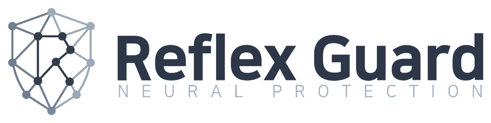
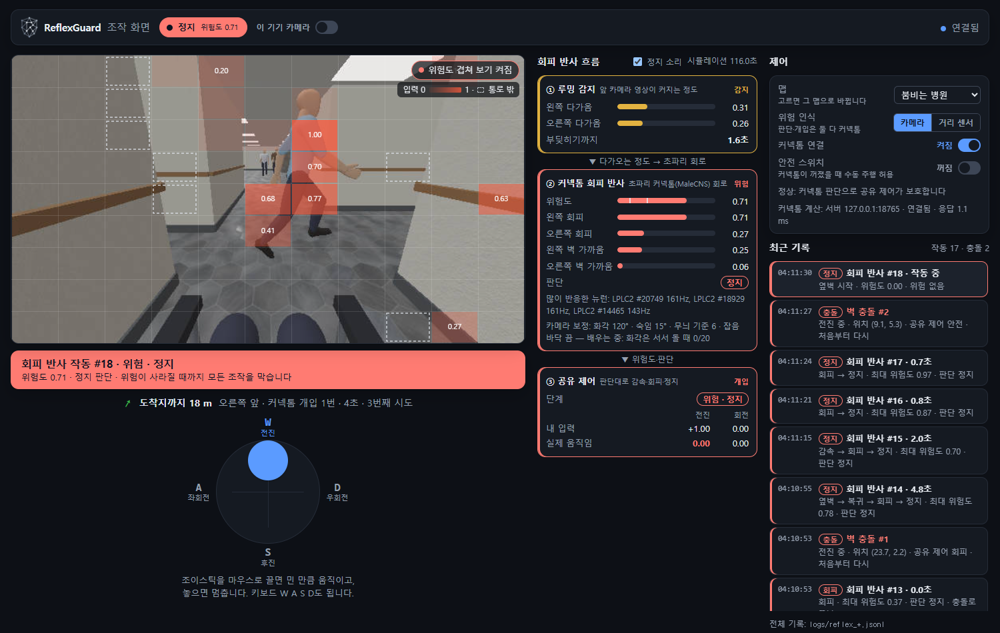
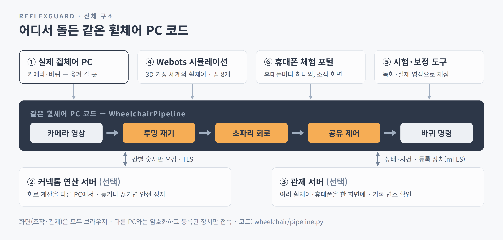
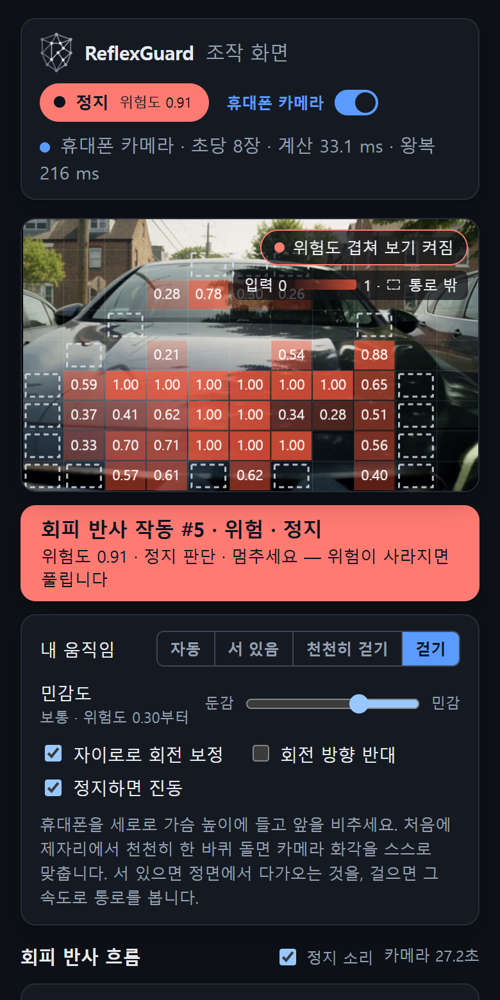
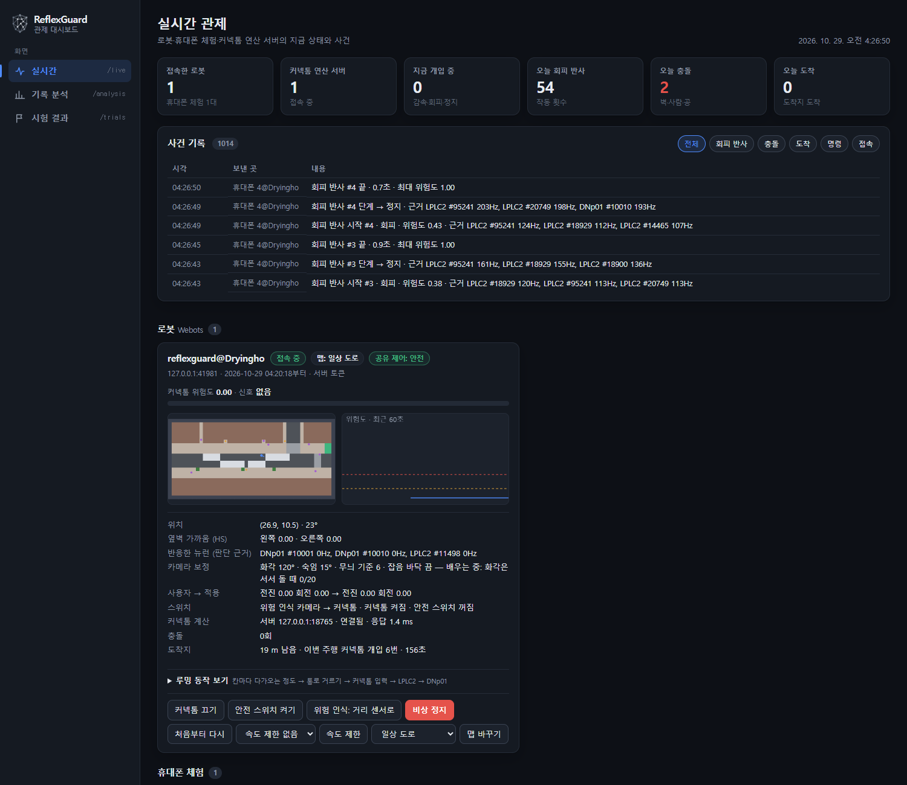
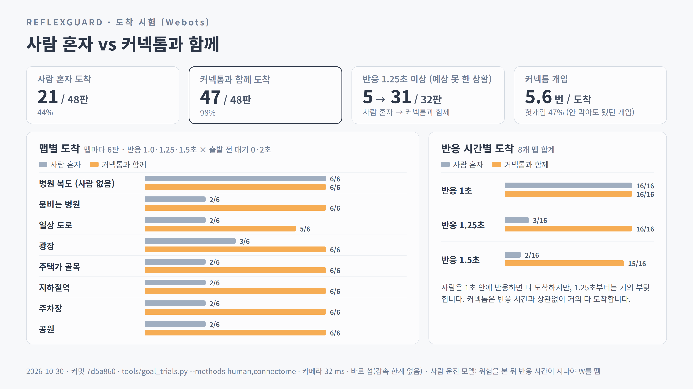

<p align="center">
  <picture>
    <source media="(prefers-color-scheme: dark)" srcset="assets/brand/logo-wide-dark.png">
    
  </picture>
</p>

# ReflexGuard — 초파리 뇌 회로로 위험을 피하는 휠체어 공유 제어

**카메라 한 대로 다가오는 위험을 알아채, 사람의 운전을 위험할 때만 도와주는 휠체어**입니다.



## 목차

1. [프로젝트 개요](#1-프로젝트-개요)
2. [주요 기능](#2-주요-기능)
3. [보안 기능](#보안-기능)
4. [결과](#4-결과)
5. [설치와 실행 (Setup)](#5-설치와-실행-setup)
6. [어택랩](#6-어택랩)
7. [폴더 구성](#7-폴더-구성)
8. [범위와 출처](#8-범위와-출처)

## 1. 프로젝트 개요

### 문제

- 전동 휠체어 사용자는 갑자기 튀어나오는 사람·물체나 좁은 통로의 벽에 부딪히기 쉽습니다.
- 사람의 반응 시간은 약 1.0~1.5초라, 보고 나서 피하면 늦는 경우가 있습니다.
- 기존 방법에도 한계가 있습니다.
  - **거리 센서**: 가까운 것에 모두 반응해 불필요한 개입이 많습니다.
  - **딥러닝 물체 인식**: 학습 데이터가 필요하고, 배우지 않은 것(예: 벽)은 놓칩니다.

### 아이디어 — 초파리의 회피 반사

초파리는 다가오는 물체를 보면 아주 빠르게 피합니다. 이 반사를 맡는 회로가 밝혀져 있습니다.

- **LPLC2**: 화면에서 커지는 것(루밍 — 물체가 다가오며 화면에서 커지는 정도)을 알아채는 시각 뉴런
- **DNp01**(거대 섬유): LPLC2 신호를 모아 '피하라'를 내리는 뉴런
- **HS 세포**: 옆으로 흐르는 영상으로 어느 쪽 벽이 가까운지 아는 뉴런

초파리 수컷의 전체 연결 지도(커넥톰) **MaleCNS v1.0**(공개 데이터)에서 이 회로를 뽑아, **학습 없이** 실제 시냅스 수를 연결 세기로 그대로 계산에 씁니다.

### 처리 흐름

```
카메라 영상 ─▶ ① 다가옴 재기 ─────▶ ② 초파리 회피 반사 회로 ─▶ ③ 공유 제어 ─────────▶ 바퀴
               (루밍: 칸마다 화면에서     (LPLC2 → DNp01,             (위험할 때만 감속·
                커지는 빠르기)            HS → 옆벽 가까움)            회피·정지)
```

- 평소에는 사람이 조이스틱(또는 키보드 W·A·S·D)으로 운전합니다.
- 위험이 보이면 커넥톰이 위험도와 피할 방향을 내고, **공유 제어**가 사람의 명령을 그때만 고쳐 바퀴로 보냅니다.
- 거리 센서 없이 **카메라 영상만으로** 판단합니다.

### 전체 구조



| 파트 | 폴더 | 하는 일 |
|---|---|---|
| ① 휠체어 PC | `wheelchair/` | 영상 → 루밍 → 커넥톰 → 공유 제어 → 바퀴 명령. 혼자서도 동작 (영상 파일·웹캠으로도) |
| 커넥톰 회로 | `connectome/` | MaleCNS에서 뽑은 LPLC2·DNp01·HS 회로와 서명된 데이터 |
| ② 커넥톰 연산 서버 | `brain_server/` | 커넥톰 계산을 다른 PC에서 (선택) |
| ③ 관제 서버 | `dashboard/` | 여러 휠체어·휴대폰을 한 화면에서, 기록 분석 (선택) |
| ④ Webots 시뮬레이션 | `simulation/` | 실제 휠체어 대신 3D 가상 세계(맵 8개)에서 운전 |
| ⑥ 체험·조작 포털 | `demo/` | 브라우저 조작 화면, 휴대폰 카메라 체험 |
| 공용 | `common/` | 설정값, 명령 형식, 로그인·암호화 |

(그림의 ⑤ 시험·보정 도구는 개발용이라 이 제출본에 넣지 않았습니다.)

시뮬레이션·휴대폰 체험·영상 도구가 모두 **같은 휠체어 PC 코드**(`wheelchair/pipeline.py`의 `WheelchairPipeline`)를 부릅니다. 그래서 시뮬레이션에서 확인한 것이 그대로 실제 휠체어 코드가 됩니다.

## 2. 주요 기능

| 기능 | 설명 |
|---|---|
| **위험 단계별 개입** | 위험도에 따라 감속 → 회피(위험의 반대쪽으로 꺾기) → 정지. 정지한 뒤에는 위험이 사라질 때까지 조작을 막습니다 |
| **옆벽 피하기** | HS 세포로 옆벽이 가까운 쪽을 알아 살짝 떼어 놓습니다 |
| **안전 정지 (fail-safe)** | 커넥톰 판단이 늦거나 끊기면, 또는 움직이는데 카메라가 멈추면 멈춥니다 |
| **웹 조작 화면** | 영상·조이스틱·위험도 겹쳐 보기·회피 반사 흐름(루밍 → 커넥톰 → 공유 제어)·최근 기록을 한 화면에 |
| **휴대폰 카메라 체험** | 휴대폰을 들고 걸으면 같은 판단이 돌아, 다가오는 것 앞에서 '정지'와 소리·진동이 납니다 |
| **관제 화면** | 여러 휠체어·휴대폰의 상태, 비상 정지·속도 제한 명령, 기록 분석 |
| **Webots 맵 8개** | 병원 복도·붐비는 병원·일상 도로·광장·주택가 골목·지하철역·주차장·공원 (튀어나오는 사람 포함) |
| **영상 파일로 돌리기** | `python -m wheelchair.run --video 주행.mp4 --out 결과.mp4`로 실제 영상에 위험도를 겹쳐 봅니다 |

| 휴대폰 카메라 체험 | 관제 화면 |
|---|---|
|  |  |

<a id="보안-기능"></a>

## 3. 보안 기능

KISA **소프트웨어 개발보안 가이드**(설계 20개·구현 49개 기준)와 **SW 공급망 보안 가이드라인**으로 코드를 진단하고, 14단계에 걸쳐 고쳤습니다. 조치 전 '취약' 23개·'부분' 16개 → 조치 후 둘 다 0개입니다.

| 분야 | 조치 |
|---|---|
| 인증·권한 | 모든 화면·서버에 토큰 로그인(약한 토큰 거부), 조작 / 보기 전용 권한 분리, 5번 틀리면 잠금, 요청 속도·동시 접속 상한 |
| 요청 위조 막기 | 명령은 JSON만, 다른 사이트의 Origin은 거부(CSRF·웹소켓 가로채기), CSP 등 보안 헤더 |
| 통신 암호화 | 다른 PC와는 TLS 1.2 이상 + 서버 인증서 지문 고정, 등록된 장치만 접속(mTLS), 장치 열쇠 폐기 |
| 명령 무결성 | 원격 명령에 장치 서명·대상·접속 nonce·순번 — 바꾸거나 다시 보낸 명령 거부 |
| 기록 무결성 | 관제 기록 줄마다 HMAC 사슬·파일마다 봉인 (고침·뺌·끼움 탐지), 기록 파일 권한 0600 |
| 데이터 무결성 | 커넥톰 데이터에 Ed25519 서명 — 불러올 때마다 확인, 한 바이트만 바뀌어도 거부 |
| 공급망 | 의존성 버전·SHA-256 해시 고정(`requirements.txt`), 랩 이미지 다이제스트 고정, SBOM(`sbom/`, CycloneDX) |
| 노출 줄이기 | 서버는 기본 127.0.0.1에만, Webots 웹 서버는 루프백으로 강제(`simulation/webots/loopback_only.c`) |

손으로 점검하려면 `bash setup.sh security`(파일 권한·열린 포트·기록 무결성·bandit·pip-audit)를 씁니다. 조치 전·후를 직접 공격해 비교하는 실습은 [어택랩](#6-어택랩)에 있습니다.

## 4. 결과

Webots 8개 맵에서 6판씩(모두 48판), 사람의 반응 시간(1.0·1.25·1.5초)을 흉내 낸 **운전 모델**이 운전했습니다. 같은 맵·같은 운전을 (1) 사람 혼자 (2) 커넥톰과 함께 달려 도착률을 비교했습니다(2026-10-30).



- **사람 혼자**: 반응 1.0초면 모두 도착하지만, 1.25초 이상(예상 못 한 상황)이면 32판 중 5판만 도착합니다.
- **커넥톰과 함께**: 반응 시간과 상관없이 48판 중 47판 도착합니다(남은 1번은 반응 1.5초에서 옆길 아이).
- 커넥톰은 도착 한 번에 평균 5.6번 개입했습니다. 그중 47%는 그대로 두었어도 부딪히지 않았을 개입(헛개입)입니다.
- **한계**: 실제 휠체어·카메라에는 아직 올려 보지 않았습니다. 가려진 곳에서 갑자기 나와 옆에서 들어오는 사람처럼 '커지지 않고 나타나는' 위험에는 늦게 반응합니다.

## 5. 설치와 실행 (Setup)

명령은 모두 저장소 폴더 안에서 칩니다. `setup.sh`가 이 PC에 무엇이 있는지 보고 **빠진 것만** 설치하므로, 여러 번 실행해도 괜찮습니다.

### 준비

1. **운영체제**: Ubuntu 22.04·24.04. Windows라면 WSL2의 Ubuntu 안에서 합니다. (파이썬 파트는 Debian·Fedora·Arch·openSUSE·Alpine·macOS도 됩니다. Webots는 리눅스 x86-64·macOS만.)
2. **계정**: `sudo`를 쓸 수 있어야 하고, 처음 한 번은 인터넷이 필요합니다(파이썬 패키지·Webots 받기).
3. **코드 받기**:

```bash
git clone https://github.com/dryingho/reflexguard-submit.git
```

```bash
cd reflexguard-submit
```

### 이 PC는 무엇을 하나요?

PC의 역할에 따라 설치 명령과 실행 명령이 짝으로 정해져 있습니다.

| 이 PC의 역할 | 설치 | 실행 |
|---|---|---|
| **PC 한 대로 전부** (처음이라면 이것) | `bash setup.sh install sim` | `bash scripts/run.sh` |
| **서버 PC** — 관제·연산 서버·휴대폰 체험 | `bash setup.sh install dashboard brain portal` | `bash scripts/run_server.sh` |
| **Webots PC** — 시뮬레이션만, 서버 PC에 붙음 | `bash setup.sh install sim` | `bash scripts/run_sim.sh` |
| **휠체어 PC** — 카메라·영상으로 (Webots 없음) | `bash setup.sh install wheelchair` | `.venv/bin/python -m wheelchair.run --video 주행.mp4` |

> `run.sh`·`run_sim.sh`는 Webots를 켜므로 `sim`으로 설치한 PC에서만 됩니다.

### PC 한 대로 쓰기

**1) 설치**

```bash
bash setup.sh install sim
```

파이썬 가상환경(`.venv`)과 numpy(해시 확인), Webots R2025a, 로그인 토큰까지 한 번에 준비됩니다. 중간에 묻는 것에는 이렇게 답합니다.

| 질문 | 답 |
|---|---|
| 위 패키지를 설치할까요? / Webots R2025a를 설치할까요? | `y` |
| 다른 PC에서 이 PC의 관제·연산 서버에 붙나요? | `n` |
| 관제 서버 주소 / 커넥톰 연산 서버 주소 | 그냥 Enter |

**2) 실행**

```bash
bash scripts/run.sh road
```

관제 서버 → 연산 서버 → 조작 포털 → Webots 순서로 켜집니다. `road` 자리에 맵 이름을 넣습니다: `hospital` `hospital_busy` `road` `plaza` `alley` `station` `parking` `park` (비우면 `hospital`).

**3) 화면 열기**

| 화면 | 주소 |
|---|---|
| 조작 화면 (영상·조이스틱·위험도) | <http://localhost:8443> |
| 관제 화면 (실시간·기록 분석) | <http://localhost:8080/live> |

- 처음 열면 **로그인 토큰**을 묻습니다. `run.sh`를 켠 터미널에 나오고, 다시 보려면 `.venv/bin/python -m common.auth`.
- `W`/`S` 전진·후진, `A`/`D` 회전, 또는 화면의 조이스틱. 바닥의 **초록 바둑판**이 도착지입니다.
- 휴대폰·다른 PC에서 열려면 `bash scripts/run.sh --public`으로 켜고 `https://<PC 주소>:8443`을 엽니다(자체 인증서라 처음에 경고가 한 번 나옵니다).

**4) 끄기**: Webots 창을 닫으면 연산 서버와 포털이 같이 꺼집니다. 관제 서버까지 끄려면 `bash scripts/stop_dashboard.sh`.

### 여러 PC로 나눠 쓰기

서버 PC를 **먼저** 설치하고 켠 다음, 다른 PC를 설치합니다(다른 PC는 설치하면서 서버에 접속해 확인합니다). 주소·토큰·인증서는 `setup.sh`가 PC마다 `reflexguard.local.env`(이 계정만 읽음, git에 올라가지 않음)에 저장합니다.

**① 서버 PC**

```bash
bash setup.sh install dashboard brain portal
```

- "다른 PC에서 붙나요?"에 `y`, 이 PC를 부를 이름·주소는 보여 주는 값 그대로(고정 IP 권장).
- 끝에 나오는 **공개키 지문(`sha256:…`)**을 적어 둡니다. 다른 PC를 설치할 때 맞춰 봅니다.
- 붙을 PC에 줄 **조작 토큰**은 `.venv/bin/python -m common.auth`로 확인합니다.

```bash
bash scripts/run_server.sh
```

관제 서버(8080·8766), 커넥톰 연산 서버(8765), 휴대폰 체험 포털(8443)이 함께 켜집니다. 휴대폰은 `https://<서버 PC 주소>:8443`을 열면 바로 카메라로 시작합니다.

**② Webots PC**

```bash
bash setup.sh install sim
```

| 질문 | 답 |
|---|---|
| 다른 PC에서 이 PC의 관제·연산 서버에 붙나요? | `n` |
| 관제 서버 주소 | `tls://<서버 PC 주소>:8766` |
| 커넥톰 연산 서버 주소 | 그냥 Enter (이 PC에서 계산) |
| 지문이 같습니까? | 서버 PC에서 적어 둔 지문과 같으면 `y` |
| 서버 PC의 조작 토큰 | 서버 PC에서 확인한 토큰 (화면에 보이지 않음) |

```bash
bash scripts/run_sim.sh road
```

Webots가 열리고 서버 PC의 관제 화면에 이 PC가 나타납니다. 카메라는 기본 64 ms마다 찍습니다(`--camera-ms 32`로 바꿈).

**③ 휠체어 PC** (Webots 없이 카메라·영상으로)

```bash
bash setup.sh install wheelchair
```

```bash
.venv/bin/python -m wheelchair.run --video 주행.mp4 --out 결과.mp4
```

- 웹캠은 `--camera /dev/video0`. 휠체어에 단 카메라면 `--no-handheld`, 속도를 알면 `--speed 1.0`(m/s).
- 관제 서버 주소는 `tls://<서버 PC 주소>:8766`, 연산 서버는 서버 PC에서 계산하려면 `tls://<서버 PC 주소>:8765`(아니면 Enter).
- 결과 영상을 만들려면 `ffmpeg`가 필요합니다(설치할 때 함께 묻습니다).

**WSL을 쓰는데 다른 기기가 붙지 않으면** Windows 방화벽 때문입니다. Windows의 **관리자 PowerShell**에서 포트를 엽니다.

```powershell
New-NetFirewallHyperVRule -Name ReflexGuardServer -DisplayName "ReflexGuard server" -Direction Inbound -VMCreatorId '{40E0AC32-46A5-438A-A0B2-2B479E8F2E90}' -Protocol TCP -LocalPorts 8080,8443,8765,8766
```

### 확인·관리

| 할 일 | 명령 |
|---|---|
| 무엇이 있고 없는지, 서버에 닿는지 | `bash setup.sh check` |
| 지금 켜져 있는 서버 | `bash setup.sh status` |
| 보안 점검 (권한·포트·기록·취약점) | `bash setup.sh security` |
| 주소·토큰·서버를 다시 정하기 | `bash setup.sh config` |
| 설치한 실행 환경 지우기 (기록·토큰은 남음) | `bash setup.sh clean` |

### 막힐 때

| 증상 | 해결 |
|---|---|
| `Webots를 찾지 못했습니다` | Webots 없는 PC에서 `run.sh`·`run_sim.sh`를 켠 것입니다. 서버 PC는 `run_server.sh`, Webots를 돌릴 PC는 먼저 `bash setup.sh install sim` |
| sudo 권한이 없음 | 설치 명령 끝에 `--no-system`. 파이썬 부분만 하고, 관리자에게 부탁할 명령을 알려 줍니다 |
| 묻지 않고 설치 | 끝에 `--yes` (여러 PC 설정이면 `--pin sha256:…`로 지문도 함께) |
| 할 일만 미리 보기 | 끝에 `--dry-run` (아무것도 바꾸지 않음) |
| 다른 PC가 서버에 닿지 않음 | 서버 PC에서 `run_server.sh`가 켜져 있는지, 설치 때 "다른 PC에서 붙나요?"에 `y`라고 했는지 확인. WSL이면 위의 방화벽 명령 |
| 장치를 잃어버림 | 서버 PC에서 `.venv/bin/python -m common.device_auth <이름> --rotate` 후 서버를 다시 켭니다(그 장치의 열쇠·인증서 폐기) |

설치 파트 이름: `wheelchair`(휠체어 PC) · `brain`(연산 서버) · `dashboard`(관제 서버) · `portal`(조작·휴대폰 체험) · `sim`(Webots — `brain`·`dashboard`·`portal`도 함께) · `lab`(어택랩, 확인만) · `all`(전부).

## 6. 어택랩

보안 조치 **전·후의 코드를 내 PC의 격리된 도커 컨테이너에서 번갈아 띄워**, 같은 공격이 어떻게 막히는지 감사 로그로 비교하는 교육용 실습입니다. 조치 전 코드는 `attacklab/vulnerable/`에 그대로 얼려 두었습니다. 포트는 `127.0.0.1`에만 엽니다.

```bash
cd attacklab && docker compose up --build
```

```bash
cd attacklab && LAB_VERSION=after docker compose up --build
```

| 연습 | 다루는 약점 |
|---|---|
| [01 인증 없음](attacklab/exercises/01-no-auth.md) | 토큰 없이 화면·데이터 읽기 |
| [02 명령 위조](attacklab/exercises/02-command-forgery.md) | 인증 없는 비상 정지, 다른 사이트 폼의 위조 명령 |
| [03 요청 폭주](attacklab/exercises/03-flooding.md) | 속도 제한 없음, 토큰 추측, 끝없는 줄 |
| [04 평문 통신](attacklab/exercises/04-plaintext-and-connectome.md) | 로봇·서버가 주고받는 내용이 그대로 보임 |
| [05 웹소켓 가로채기](attacklab/exercises/05-cross-site-websocket.md) | 다른 사이트가 연 웹소켓으로 Webots 조작 |

도커 설치부터 끄기까지는 [attacklab/INSTALL.md](attacklab/INSTALL.md), 전체 흐름은 [attacklab/README.md](attacklab/README.md), 시연 순서는 [attacklab/DEMO.md](attacklab/DEMO.md)에 있습니다.

## 7. 폴더 구성

```
setup.sh              설치·설정·점검 (파트별)
requirements*.txt     의존성 (버전·SHA-256 해시 고정)
scripts/              실행 스크립트 (run.sh · run_server.sh · run_sim.sh · run_webots.sh …)
wheelchair/           ① 휠체어 PC — 루밍(looming/) · 공유 제어 · 파이프라인 · 영상 도구(run.py)
connectome/           커넥톰 회로(brain.py)와 MaleCNS에서 뽑은 데이터(data/, 서명)
brain_server/         ② 커넥톰 연산 서버
dashboard/            ③ 관제 서버와 관제 화면(web/)
simulation/           ④ Webots 월드·컨트롤러·맵·사람 동작
demo/                 ⑥ 체험·조작 포털 (휴대폰 카메라 체험)
common/               설정값 · 로그인 · TLS · 장치 인증 · 기록 무결성
attacklab/            어택랩 (조치 전 고정본 vulnerable/ · 연습 exercises/)
tools/                보안 점검 잠금 파일 · 기록 확인(verify_logs.py)
sbom/                 SBOM (CycloneDX)
assets/ screenshots/  로고·그림·화면 캡처
```

실행하면 생기는 `logs/`(작동 기록·토큰)·`.venv/`·`reflexguard.local.env`는 저장소에 넣지 않습니다.

## 8. 범위와 출처

- 기획서의 **① 루밍 감지 → ② 커넥톰 회피 반사 → ③ 공유 제어**를 1단계 범위로 만들었습니다.
- 실제 휠체어·카메라에는 아직 올려 보지 않았습니다. 휠체어 PC 코드는 카메라 영상과 바퀴의 움직임만 받도록 만들어, Webots 연결 부분만 바꾸면 되게 했습니다.
- **커넥톰 데이터**: MaleCNS v1.0 (HHMI Janelia·케임브리지대·MRC LMB·구글 리서치), [CC-BY-4.0](https://creativecommons.org/licenses/by/4.0/). `connectome/data/`에 있고, 뽑은 방법은 `connectome/extract_malecns_*.py`에 있습니다.
- **시뮬레이터**: [Webots](https://cyberbotics.com) R2025a (Cyberbotics, Apache-2.0)와 그 3D 에셋.
